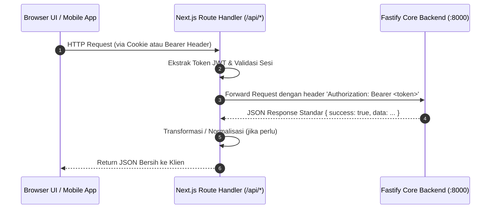

# 📋 Product Requirements Document — Web Dashboard & BFF (PRD-Web)
# Integrated Hospital Water Tank Monitoring & Early Warning System (RSA UGM)
### Platform: Next.js Web Dashboard & Backend-for-Frontend (BFF)

> **Repositori Target Pengembangan:** `frontend-web-rsa-ugm`  
> **Parent Documentation:** [`../PRD-MFE.md`](../PRD-MFE.md) *(Master Frontend PRD)* & [`../PRD.md`](../PRD.md) *(Backend Core)*  
> **Arsitektur:** Next.js 16.3 (App Router), React 19, Tailwind CSS v4, Zustand v5, Recharts v3, Lucide Icons  
> **Port Pengembangan:** `http://localhost:3000` (UI Web & Rute BFF)  
> **Status Dokumen:** Acuan Tunggal Spesifikasi Frontend Web & Rute BFF

---

## 1. Deskripsi Singkat, Visi & Peran Ganda Web

### 1.1 Visi Produk Web
Web Dashboard dirancang khusus untuk memonitor ketersediaan air rumah sakit secara terpusat melalui monitor **ultrawide / high-resolution** di ruang pengawas fasilitas (*control room*) Rumah Sakit Akademik UGM. Antarmuka harus menyajikan data multi-tangki secara komprehensif, cepat, responsif, dan memberikan sinyal darurat (*early warning*) yang mencolok seketika terjadi penurunan volume air.

### 1.2 Peran Ganda (Web Client + BFF Provider)
Repositori `frontend-web-rsa-ugm` memiliki **dua tanggung jawab utama**:
1. **Antarmuka Pengguna Web (Web UI Client):** Menyajikan dashboard visual, grafik analitik time-series, panel peringatan darurat, serta modul administratif untuk pengelola rumah sakit.
2. **Backend-for-Frontend (BFF) Provider:** Menjalankan lapisan perantara di sisi server (`src/app/api/*`) yang melayani klien Web sendiri dan klien **Mobile App (Android Expo)**. BFF bertugas:
   * Menjembatani komunikasi data ke Core Backend Fastify (`:8000`).
   * Mengamankan sesi pengguna Web dengan cookie `HttpOnly; SameSite=Lax; Secure` (anti-XSS).
   * Meneruskan token JWT murni kepada aplikasi Mobile.
   * Menyeragamkan format respon JSON agar komponen UI siap merender data tanpa manipulasi logika yang berat.

### 1.3 Batasan Ruang Lingkup Mutlak (Scope Boundaries)
* **Monitoring & Early Warning Only:** Web Dashboard fokus murni pada pemantauan level air, deteksi peringatan bahaya, konfirmasi penyelesaian alert (*Resolve Alert*), visualisasi time-series, dan manajemen data.
* **DILARANG MEMBUAT KONTROL POMPA:** Tidak ada tombol on/off pompa, saklar aktuator, atau katup fisik apa pun di UI. Seluruh instruksi aktuator ditiadakan dari sistem demi keselamatan fasilitas rumah sakit.

---

## 2. Tech Stack & Standar Lingkungan Pengembangan

| Komponen / Pustaka | Versi Terpasang | Peran & Penggunaan |
| :--- | :--- | :--- |
| **Framework Inti** | Next.js 16.3.6 (App Router) | Server-Side Rendering (SSR), Client Components, & Route Handlers (BFF) |
| **UI Library** | React 19.2.x & ReactDOM 19.2.x | Pustaka rendering UI berbasis komponen fungsional |
| **Styling & Theme** | Tailwind CSS v4 (@tailwindcss/postcss) | Utility-first CSS dengan CSS variables untuk dark/light medical mode |
| **State Management** | Zustand v5.0.x | Global client state (Tank Store, Alert Store, Auth Store, Device Store) |
| **Grafik Time-Series** | Recharts v3.10.x | Grafik area dan garis interaktif untuk visualisasi histori 24 jam |
| **Icon Pack** | Lucide React v1.47.x | Ikonografi modern (tangki, sinyal, alert, user, settings, log) |
| **HTTP Client** | Native `fetch` (ES2022) | Komunikasi asinkron server-to-server BFF dan client-to-BFF |
| **Package Manager** | `pnpm` v11.5.x | Package manager wajib untuk efisiensi disk dan instalasi deterministik |
| **Linter & Typecheck**| ESLint 9 & TypeScript 5.x | Menjamin type-safety dan kepatuhan standar kode |

### Variabel Lingkungan (`.env.local`)
```env
# Koneksi Server-to-Server BFF ke Core Backend Fastify
CORE_BACKEND_URL=http://localhost:8000

# URL WebSocket Realtime (Dihubungi langsung oleh Browser)
NEXT_PUBLIC_WS_URL=ws://localhost:8000/ws

# Environment Mode
NODE_ENV=development
```

---

## 3. Struktur Direktori & Arsitektur Layout Modular

Struktur folder `frontend-web-rsa-ugm/src` disusun secara modular memisahkan UI Halaman, Rute BFF, Komponen Reusable, dan State Management:

```text
src/
├── app/
│   ├── (auth)/
│   │   └── login/
│   │       └── page.tsx              # Layar Login Pengguna
│   ├── (dashboard)/
│   │   ├── layout.tsx                # DashboardLayout (Sidebar, Topbar, WebSocket Provider)
│   │   ├── page.tsx                  # Dashboard Overview (Multi-tank grid, alert banner)
│   │   ├── tanks/
│   │   │   ├── page.tsx              # Daftar Master Tangki & Pengaturan
│   │   │   └── [id]/
│   │   │       └── page.tsx          # Detail Tangki Tunggal & Grafik 24 Jam
│   │   ├── alerts/
│   │   │   └── page.tsx              # Riwayat Peringatan & Panel Resolve Alert
│   │   ├── devices/
│   │   │   └── page.tsx              # Status Gateway RPi & Node STM32
│   │   ├── users/
│   │   │   └── page.tsx              # Manajemen Pengguna (Khusus Admin)
│   │   ├── logs/
│   │   │   └── page.tsx              # Audit Trail Jejak Aktivitas Sistem
│   │   ├── profile/
│   │   │   └── page.tsx              # Profil Pengguna & Unggah Foto Profil Lokal
│   │   └── reports/
│   │       └── page.tsx              # Ekspor Laporan Data Sensor & Alert (.CSV)
│   ├── api/                          # LAPISAN BACKEND-FOR-FRONTEND (BFF)
│   │   ├── auth/
│   │   │   ├── login/route.ts        # POST: Login & Set Cookie HTTP-Only
│   │   │   ├── me/route.ts           # GET: Profil user dari cookie/Bearer
│   │   │   ├── token/route.ts        # GET: Ambil JWT untuk WebSocket browser
│   │   │   └── logout/route.ts       # POST: Hapus cookie auth
│   │   ├── tanks/
│   │   │   ├── route.ts              # GET (list) & POST (tambah tangki)
│   │   │   └── [id]/
│   │   │       ├── route.ts          # GET (detail), PATCH/PUT (edit), DELETE
│   │   │       └── readings/route.ts # GET: Time-series log tangki spesifik (?hours=&limit=)
│   │   ├── readings/
│   │   │   ├── latest/route.ts       # GET: Fallback polling level air
│   │   │   └── history/route.ts      # GET: Riwayat pembacaan multi-tangki (?hours=)
│   │   ├── alerts/
│   │   │   ├── route.ts              # GET: Daftar alert aktif / riwayat (?status=)
│   │   │   └── [id]/
│   │   │       └── resolve/route.ts  # PATCH/PUT: Selesaikan alert manual
│   │   ├── gateways/route.ts         # GET: Status Raspberry Pi Hub
│   │   ├── nodes/route.ts            # GET: Status modul sensor STM32
│   │   ├── users/
│   │   │   ├── route.ts              # GET & POST (CRUD User Admin)
│   │   │   └── [id]/route.ts         # PATCH/PUT & DELETE User
│   │   ├── audit-logs/route.ts       # GET: Rekaman audit aktivitas (?page=&limit=&entity=)
│   │   ├── reports/
│   │   │   ├── readings/export/route.ts # GET: Proksi download CSV readings
│   │   │   └── alerts/export/route.ts   # GET: Proksi download CSV alerts
│   │   └── health/route.ts           # GET: Health check BFF & Fastify
│   ├── globals.css                   # Tailwind v4 tema & CSS variables
│   └── layout.tsx                    # Root Layout (Fonts, Global Providers)
├── components/
│   ├── ui/
│   │   ├── Sidebar.tsx               # Navigasi samping dengan state role aktif
│   │   ├── Header.tsx                # Topbar dengan status server, profil & lonceng alert
│   │   ├── Card.tsx                  # Base card surface
│   │   ├── LiquidLevelGauge.tsx      # Komponen visual silinder tangki dinamis
│   │   ├── AlertBanner.tsx           # Floating warning banner darurat di header
│   │   ├── TimeSeriesChart.tsx       # Recharts area/line chart interaktif 24 jam
│   │   ├── Modal.tsx                 # Modal dialog reusable (Single-Lock pattern)
│   │   ├── Badge.tsx                 # Indikator status (Normal, Warning, Critical)
│   │   └── Table.tsx                 # Tabel data generik dengan pagination & filter
├── hooks/
│   ├── useRealtimeSocket.ts          # Hook koneksi WebSocket ke ws://...:8000/ws?token=
│   ├── useProfilePhoto.ts            # Penyimpanan & sinkronisasi foto profil lokal per user ID
│   └── useBFF.ts                     # Fetcher wrapper dengan proteksi error handling
├── stores/
│   ├── tankStore.ts                  # Zustand state tangki air
│   ├── alertStore.ts                 # Zustand state alert bahaya
│   ├── authStore.ts                  # Zustand state user, role & auth status
│   └── deviceStore.ts                # Zustand state status gateway & node
└── lib/
    ├── bffProxy.ts                   # Helper proksi BFF + normalisasi lokasi Vokasi UGM
    ├── vokasiLocations.ts            # Koordinat SV UGM & normalisasi nama DTEDI/DTK/DLIKES
    ├── constants.ts                  # URL, status color codes, threshold constants
    └── utils.ts                      # Format angka liter, persen, waktu ISO
```

---

## 4. Rincian Implementasi Halaman & Fitur Web

### 4.1 Halaman Login (`/login`)
* **Tujuan:** Autentikasi petugas fasilitas dan administrator rumah sakit.
* **Elemen UI:**
  * Logo resmi RSA UGM & Judul: *"SI-POTA v1.0 — Sistem Informasi Pemantauan Tangki Air"*.
  * Input `username` dan `password`.
  * Tombol Submit *"Masuk ke Sistem"*.
  * Indikator pesan error jika kredensial salah (HTTP `401`/`403`) maupun saat terkena batas percobaan login (*rate limit* HTTP `429` dengan penerusan header `Retry-After` dari Core Backend).
* **Alur Teknis:** Request dikirim ke `POST /api/auth/login` (BFF). Jika berhasil, BFF memasang cookie `auth_token` dan mengarahkan pengguna ke halaman `/`.

---

### 4.2 Dashboard Overview (`/`) — Layar Utama Ultrawide
* **Tujuan:** Tampilan monitoring utama terpadu yang dipajang di layar besar ruang kontrol maupun perangkat desktop operator.
* **Komponen & Tata Letak:**
  * **Header Alert Bar & Notifikasi Popover (`AlertBanner.tsx` / `NotificationPopover.tsx`):**
    * Peringatan darurat otomatis menyala jika ada alert aktif berstatus `CRITICAL` ($<30\%$) atau `WARNING` ($30-60\%$) dengan animasi badge menyala.
    * Lonceng notifikasi dengan counter badge dan popover ringkasan insiden aktif secara realtime.
  * **Ringkasan Kartu Metrik Cepat & Kontrol Filter Tanggal (`DashboardOverview.tsx`):**
    * Total Tangki Dipantau, Total Kapasitas Air (Liter), Tangki Kondisi Aman, Tangki Peringatan/Kritis.
    * Pemilih rentang tanggal kalender interaktif (`DashboardDatePicker` popover) dan pencarian filter tangki.
  * **Peta Satelit Interaktif Leaflet (`TankMap.tsx`):**
    * Peta satelit berbasis citra ArcGIS World Imagery dengan titik koordinat presisi pilot di lingkungan **Sekolah Vokasi UGM**:
      * **DTEDI**: `7°46'30.42"S, 110°22'25.18"E` (terpetakan dari *Tangki Atap Gedung Utama*).
      * **DTK**: `7°46'29.21"S, 110°22'27.76"E` (terpetakan dari *Tangki Gedung Rawat Inap*).
      * **DLIKES**: `7°46'25.81"S, 110°22'27.85"E` (disajikan dengan marker garis putus-putus / *dashed outline* sebagai placeholder sebelum sensor terpasang).
    * Marker pin SVG kustom dilengkapi **tooltip label permanen** di atas pin dan warna dinamis sesuai status tangki (Hijau: Normal, Kuning: Peringatan, Merah: Kritis).
    * Modal popup ringkasan instan saat marker diklik: menampilkan level air, volume liter, koordinat derajat/menit/detik, dan tautan *"View details"*.
    * Fitur kontrol peta: Auto-fit bounds lokasi SV UGM, filter status (*All, Normal, Warning, Critical*), filter area gedung (*All, DTEDI, DTK, DLIKES*), dan mode layar penuh (*Maximize / Minimize*).
  * **Visualisasi Level Air Bejana Dinamis (`TankLevel.tsx`):**
    * Gauge bejana silinder air dengan skala persentase ($0\%$ s.d. $100\%$) dan animasi gelombang air (*SVG wave animation*).
    * Informasi metrik terperinci: level air (%), volume liter terkini, kapasitas total, kode perangkat sensor (node), sinyal radio RSSI (dBm), dan timestamp pembaruan.
  * **Tingkat Pengisian & Statistik Distribusi Tangki (`TankStatistics.tsx`):**
    * Donat chart persentase keterisian air (*conic-gradient*) dengan indikator kategori: **Normal** ($>60\%$, `#52c93f`), **Warning** ($30-60\%$, `#fecb28`), dan **Critical** ($<30\%$, `#ff2727`).
    * Otomatisasi aliasing nama tangki backend ke kode gedung SV UGM (`DTK`, `DTEDI`, `DLIKES`) dengan urutan terstandarisasi (DTK $\rightarrow$ DTEDI $\rightarrow$ DLIKES).
    * Sisipan otomatis placeholder gedung `DLIKES` jika telemetri sensor belum aktif agar cakupan 3 gedung pilot tetap terpantau menyeluruh.
    * Navigasi paginasi 2 tangki per halaman dengan kontrol aksesibel berlabel bahasa Indonesia (*Sebelumnya*, *Berikutnya*, *Halaman X/Y*).
  * **Analitik Tren Level Air (`WaterLevelAnalytics.tsx` di `TankDashboard.tsx`):**
    * Visualisasi Recharts `AreaChart` interaktif yang menampilkan fluktuasi persentase dan volume air dengan filter pemilihan tangki (`ALL` atau tangki spesifik) serta rentang periode (default `24` jam) berbasis data dari `GET /api/readings/history?hours=...` atau `GET /api/tanks/:id/readings?hours=...&limit=500`.
  * **Ringkasan Riwayat Login Terkini (`RecentLogins` / `RecentLogins.module.css`):**
    * Tabel audit singkat menampilkan aktivitas login terakhir pengguna (paginasi 10 entri per halaman) dari `/api/audit-logs` lengkap dengan avatar, username, role, dan waktu login.

---

### 4.3 Detail Tangki & Grafik Histori (`/tanks/[id]`)
* **Tujuan:** Analisis mendalam kondisi 1 tangki tertentu.
* **Elemen UI:**
  * Silinder air ukuran besar dengan batas threshold garis putus-putus (`minThresholdPercent` dan `maxThresholdPercent`).
  * Rentang Filter Grafik: Pilihan tombol waktu `24 Jam`, `7 Hari`, `30 Hari`.
  * Grafik Garis Recharts interaktif yang menampilkan titik waktu dan persentase air saat kursor diarahkan (*tooltip*).
  * Tabel 50 Riwayat Pembacaan Terakhir (Waktu Pengukuran, Persentase %, Estimasi Liter, RSSI Radio).
  * Panel Peringatan Terkait: Riwayat alert yang pernah terjadi pada tangki ini.

---

### 4.4 Panel Peringatan & Penyelesaian Alert (`/alerts`)
* **Tujuan:** Pusat komando penanganan kondisi darurat level air dan insiden sensor lapangan.
* **Elemen UI & Fitur:**
  * **Kartu Ringkasan Metrik Alert:** Tiga kartu statistik teratas: **Critical** (Merah), **Warning** (Kuning), dan **Pending** (Biru/Abu).
  * **Bilah Pencarian & Filter:**
    * Input pencarian cepat berdasarkan nama tangki, unit/device code, ID insiden, atau isi pesan alert.
    * Tab filter status: **Active** (khusus alert aktif), **All** (seluruh riwayat), dan **History** (khusus alert yang sudah diselesaikan).
    * Dropdown pemilihan tangki spesifik.
  * **Daftar Kartu Alert Interaktif:**
    * Badge tingkat keparahan (`CRITICAL` / `WARNING`), status badge (`Resolved`), dan nama tangki terdampak.
    * Waktu kejadian, ID insiden (`ALM-xxx`), dan kode unit sensor (`deviceCode`).
    * Kotak pesan peringatan otomatis beserta badge persentase level air pemicu insiden.
    * **Aksi Penanganan Terpadu:**
      * Tombol *"View Sensor"*: Membuka modal ringkasan pembacaan sensor (water level %, volume L, status, last update).
      * Tombol *"Activate Backup Pump"*: Menampilkan dialog informatif bahwa kontrol pompa belum didukung oleh backend (one-way monitoring).
      * Tombol *"Resolve Alert"* / *"Mark as Resolved"* (Khusus Role `admin` & `operator`):
        * Role `viewer` tidak dapat menyelesaikan alert (tombol dinonaktifkan).
        * Pada alert `CRITICAL`, operator wajib mengisi formulir catatan tindakan (*Action Notes*) sebelum konfirmasi penyelesaian.
        * Mengirim request ke `PATCH /api/alerts/[id]/resolve`, mencatat ke audit log, dan menghentikan status aktif alert.
  * **Panel Panduan SOP (`Panduan Penanganan Alert`):**
    * Kartu panduan standar operasional dinamis yang menyarankan langkah mitigasi langsung sesuai alert berprioritas tertinggi yang sedang aktif.
  * **Sidebar Linimasa Riwayat Insiden (`Latest Event History`):**
    * Menampilkan riwayat aksi penyelesaian alert dan pembaruan tangki terakhir dari database audit log.

---

### 4.5 Status Perangkat IoT & Gateway (`/devices`)
* **Tujuan:** Memantau keandalan perangkat keras komunikasi radio (LoRa & RPi).
* **Elemen UI:**
  * **Kartu Gateway Raspberry Pi:**
    * Kode Perangkat: `GW-HUB-01`.
    * Status: `Online` (Hijau) / `Offline` (Abu-abu/Merah).
    * Heartbeat Terakhir: Waktu sinkronisasi terakhir dari hub RPi.
  * **Tabel Node Sensor STM32:**
    * Kode Node (contoh: `NODE-TNK-01`), Tangki Terpasang, Tipe Sensor (`ultrasonic`).
    * Nilai Sinyal LoRa (RSSI): Indikator bar kekuatan sinyal (contoh: `-70 dBm` = Kuat, `-105 dBm` = Lemah).
    * Status Node: `active`, `offline`, atau `error`.

---

### 4.6 Pengaturan Master Tangki (`/tanks` — Khusus Admin)
* **Tujuan:** Pengelolaan data fisik tangki air dan kalibrasi sensor ultrasonik di lingkungan fasilitas.
* **Elemen UI:**
  * **Tabel Master Tangki:** Menampilkan daftar seluruh tangki terdaftar beserta kapasitas, lokasi, batas threshold, dan status sensor terkait.
  * **Formulir Tambah / Edit Tangki (`TankForm.tsx`):**
    * Parameter Fisik Tangki: Nama Tangki, Lokasi Gedung/Area, Kapasitas Total (Liter).
    * Batas Ambang Peringatan: Batas Minimum / Ambang Bawah (`minThresholdPercent`, default 30%) dan Batas Maksimum / Ambang Atas (`maxThresholdPercent`, default 90%).
    * Parameter Kalibrasi Sensor Ultrasonik (Core BE):
      * `min_distance_cm` (Jarak pantul saat tangki penuh / level 100%, default 30.00 cm).
      * `max_distance_cm` (Jarak pantul saat tangki kosong / level 0%, default 350.00 cm).
    * Koordinat Geografis: `latitude` dan `longitude` untuk penempatan titik tangki pada peta satelit.
  * **Aksi Hapus Tangki (`DeleteTankDialog.tsx`):** Dialog konfirmasi proteksi sebelum menghapus rekaman tangki dari database.

---

### 4.7 Manajemen Pengguna & Hak Akses (`/users` — Khusus Admin)
* **Tujuan:** Mengatur akun petugas yang berhak mengakses sistem (menu dan route hanya untuk role `admin`).
* **Elemen UI:**
  * Tabel Pengguna: `Username`, `Role` (`admin`, `operator`, `viewer`), `Status Aktif`, `Tanggal Dibuat`.
  * Tombol *"Tambah Pengguna"* (`POST /api/users`): Input username, password awal, dan pemilihan peran.
  * Aksi Edit (`PATCH /api/users/[id]`): Ubah peran (`role`), status aktif (`isActive`), atau Reset Password.
  * Aksi Hapus (`DELETE /api/users/[id]`): Menghapus akun pengguna dari sistem.

---

### 4.8 Jejak Audit & Ekspor Dokumen (`/logs` & `/reports`)
* **Halaman Audit Trail (`/logs` — Khusus Admin):**
  * Tabel linimasa seluruh aksi penting (`GET /api/audit-logs?page=1&limit=50&entity=...`): Waktu (`createdAt`), ID Pengguna (`userId`), Jenis Aksi (`LOGIN`, `RESOLVE_ALERT`, `UPDATE_TANK`, dll), Entitas Terkait (`entity`), Rincian (`detail`), Alamat IP (`ipAddress`).
* **Halaman Ekspor Laporan (`/reports`):**
  * Filter rentang tanggal: `startDate` s.d. `endDate` (ISO 8601).
  * Filter Tangki Tertentu (`tankId` wajib diisi untuk ekspor CSV sensor sesuai kontrak Core BE) dan filter tingkat keparahan alert (`level`: `WARNING` | `CRITICAL`).
  * Tombol Unduh:
    * *"Download CSV Pembacaan Sensor"* (memanggil `GET /api/reports/readings/export?tankId=...&startDate=...&endDate=...`, dengan normalisasi nama lokasi Sekolah Vokasi via `vokasiDisplayText`).
    * *"Download CSV Riwayat Peringatan"* (memanggil `GET /api/reports/alerts/export?level=...&startDate=...&endDate=...`, dengan normalisasi nama lokasi Sekolah Vokasi via `vokasiDisplayText`).

---

### 4.9 Profil Pengguna & Pengaturan Akun (`/profile`)
* **Tujuan:** Menampilkan informasi akun aktif serta pengelolaan avatar profil lokal petugas.
* **Elemen UI & Fitur:**
  * Informasi akun aktif dari `useAuthStore` (`username`, `role`, tanggal pembuatan akun berformat `id-ID` WIB).
  * Pengelolaan foto profil lokal melalui hook `useProfilePhoto.ts` (validasi format JPG/PNG/WebP maksimal 2 MB, tersimpan per `user.id` di browser dan langsung tersinkronisasi dengan avatar pada `Sidebar.tsx`).
  * Akses cepat notifikasi aktif melalui `NotificationPopover` serta tipografi lokal (`Asap`, `Inter`, `Poppins` via `next/font/local`).

---

## 5. Spesifikasi Lengkap Implementasi Rute BFF (`src/app/api/*`)

Setiap rute API Next.js bertindak sebagai *handler* server yang mengamankan token, memproksikan request ke Core Backend Fastify (`CORE_BACKEND_URL`), menerapkan normalisasi nama lokasi pilot Sekolah Vokasi (`normalizeVokasiDisplayData` pada `src/lib/bffProxy.ts` dan `vokasiDisplayText` pada rute ekspor CSV), serta mengembalikan data bersih ke klien (termasuk penerusan status `429 Too Many Requests` dan header `Retry-After` pada `/api/auth/login`):



### 5.1 Implementasi Kunci Handler BFF

#### 1. Autentikasi: `src/app/api/auth/login/route.ts`
```typescript
import { NextResponse } from "next/server";
import { cookies } from "next/headers";

export async function POST(request: Request) {
  const body = await request.json();
  const beRes = await fetch(`${process.env.CORE_BACKEND_URL}/api/auth/login`, {
    method: "POST",
    headers: { "Content-Type": "application/json" },
    body: JSON.stringify(body),
  });

  const data = await beRes.json();
  if (!beRes.ok || !data.success) {
    return NextResponse.json(data, { status: beRes.status });
  }

  const token = data.data.token;
  const cookieStore = await cookies();
  
  // Pasang cookie HTTP-Only untuk browser web (selaras JWT_EXPIRES_IN=1d Core BE)
  cookieStore.set("auth_token", token, {
    httpOnly: true,
    secure: process.env.NODE_ENV === "production",
    sameSite: "lax",
    path: "/",
    maxAge: 60 * 60 * 24, // 1 hari (selaras JWT_EXPIRES_IN=1d)
  });

  // Tetap kembalikan data user & token (token untuk kebutuhan mobile Axios)
  return NextResponse.json(data, { status: 200 });
}
```

#### 2. Profil Pengguna: `src/app/api/auth/me/route.ts`
```typescript
import { NextResponse } from "next/server";
import { cookies } from "next/headers";

export async function GET(request: Request) {
  const cookieStore = await cookies();
  const tokenFromCookie = cookieStore.get("auth_token")?.value;
  const tokenFromHeader = request.headers.get("authorization")?.replace("Bearer ", "");
  const token = tokenFromCookie || tokenFromHeader;

  if (!token) {
    return NextResponse.json({ success: false, message: "Belum login" }, { status: 401 });
  }

  const beRes = await fetch(`${process.env.CORE_BACKEND_URL}/api/auth/me`, {
    headers: { Authorization: `Bearer ${token}` },
  });

  const data = await beRes.json();
  return NextResponse.json(data, { status: beRes.status });
}
```

#### 3. Proksi Monitoring Tangki: `src/app/api/tanks/route.ts`
```typescript
import { NextResponse } from "next/server";
import { cookies } from "next/headers";

export async function GET(request: Request) {
  const cookieStore = await cookies();
  const token = cookieStore.get("auth_token")?.value || request.headers.get("authorization")?.replace("Bearer ", "");

  const headers: Record<string, string> = { "Content-Type": "application/json" };
  if (token) headers["Authorization"] = `Bearer ${token}`;

  const beRes = await fetch(`${process.env.CORE_BACKEND_URL}/api/tanks`, {
    headers,
    cache: "no-store",
  });

  const data = await beRes.json();
  return NextResponse.json(data, { status: beRes.status });
}
```

#### 5.4 Penyelarasan Skema Database Core Backend (`ops/backend/`)
Untuk memastikan server backend (`backend-rsa-ugm`) di VPS kompatibel dengan antarmuka frontend web:
1. **Migrasi Kolom Tangki (`ops/backend/20261119_add_tank_columns.sql`):**
   Jika endpoint `GET /api/tanks` di backend gagal dengan error PostgreSQL `column "min_distance_cm" does not exist`, jalankan file SQL ini pada database backend untuk menambahkan kolom `min_distance_cm`, `max_distance_cm`, `latitude`, dan `longitude`.
2. **Patch Lookup Sensor Code (`ops/backend/0001-fix-sensor-code-lookup.patch`):**
   Patch pada `TankCalculatorService` backend untuk memperbaiki bug pencarian `device_code` non-UUID agar tidak crash saat dibandingkan dengan kolom UUID `sensor_nodes.id`.

---

## 6. Integrasi WebSocket Realtime di Sisi Web Client

Komponen dashboard web tidak melakukan polling HTTP berulang kali, melainkan mendengarkan event streaming secara langsung dari Core Backend menggunakan custom hook `useWebSocket`:

### Implementasi Hook `src/hooks/useRealtimeSocket.ts`
```typescript
"use client";

import { useEffect, useRef, useState } from "react";
import { useTankStore } from "@/stores/tankStore";
import { useAlertStore } from "@/stores/alertStore";
import { useAuthStore } from "@/stores/authStore";

export function useRealtimeSocket() {
  const [isConnected, setIsConnected] = useState(false);
  const reconnectTimeoutRef = useRef<ReturnType<typeof setTimeout> | null>(null);
  const token = useAuthStore((state) => state.token);

  useEffect(() => {
    const wsToken = token || (typeof window !== "undefined" ? sessionStorage.getItem("ws_token") : null);
    if (!wsToken) return;

    const baseUrl = process.env.NEXT_PUBLIC_WS_URL || "ws://localhost:8000/ws";
    const separator = baseUrl.includes("?") ? "&" : "?";
    const wsUrl = `${baseUrl}${separator}token=${encodeURIComponent(wsToken)}`;
    let socket: WebSocket | null = null;
    let isDisposed = false;

    function connect() {
      socket = new WebSocket(wsUrl);

      socket.onopen = () => {
        setIsConnected(true);
      };

      socket.onmessage = (event) => {
        try {
          const payload = JSON.parse(event.data);
          const eventType = payload.type || payload.event;
          const data = payload.data || {};

          switch (eventType) {
            case "LEVEL_UPDATE": {
              const tankId = data.tank_id || data.tankId;
              if (!tankId) break;
              useTankStore.getState().updateTankFromWs({
                tankId,
                sensorNodeId: data.sensor_node_id || data.sensorNodeId,
                levelPercent: Number(data.level_percent ?? data.levelPercent ?? 0),
                volumeLiters: Number(data.volume_liters ?? data.volumeLiters ?? 0),
                rawValue: data.raw_value ?? data.distance_cm,
                rssi: data.rssi,
                recordedAt: data.timestamp || data.recordedAt || new Date().toISOString(),
              });
              break;
            }
            case "ALERT_TRIGGERED":
              if (data.id) {
                useAlertStore.getState().addAlertFromWs(data);
              }
              break;
            case "ALERT_RESOLVED":
              if (data.id) {
                useAlertStore.getState().resolveAlertFromWs(data.id, data.resolvedAt || payload.timestamp);
              }
              break;
            case "NODE_STATUS":
              // Pemetaan status node STM32 (data.sensor_node_id, data.status)
              break;
          }
        } catch (err) {
          console.error("[WebSocket] Gagal memproses event:", err);
        }
      };

      socket.onclose = (event) => {
        setIsConnected(false);
        // Jangan reconnect jika token ditolak / invalid (Close Code 1008)
        if (!isDisposed && event.code !== 1008) {
          reconnectTimeoutRef.current = setTimeout(connect, 3000);
        }
      };

      socket.onerror = () => {
        socket?.close();
      };
    }

    connect();

    return () => {
      isDisposed = true;
      if (reconnectTimeoutRef.current) clearTimeout(reconnectTimeoutRef.current);
      socket?.close();
    };
  }, [token]);

  return { isConnected };
}
```

---

## 7. Design System & Panduan Visual Ultrawide

### 7.1 Token Warna Status & CSS Variables
Sistem menggunakan Tailwind CSS v4 dengan tema **Hospital Clean Light Theme** (selaras dengan `PRD-MFE.md` dan Mobile App) di `globals.css`:

```css
:root {
  --color-brand-primary: #0a354c;
  --color-brand-teal: #0f766e;

  /* Status Level Air */
  --color-level-normal: #10b981;   /* Hijau: > 60% */
  --color-level-warning: #f59e0b;  /* Kuning: 30% - 60% */
  --color-level-critical: #ef4444; /* Merah: < 30% */

  /* Surface (Hospital Clean Light Theme) */
  --bg-dashboard: #f8fafc;
  --bg-card: #ffffff;
  --text-main: #0f172a;
  --text-muted: #64748b;
  --border-card: #e2e8f0;
}
```

### 7.2 Spesifikasi Komponen `LiquidLevelGauge`
* Menampilkan visual silinder tangki transparan beranimasi ombak air halus (CSS animation).
* Ketinggian gelombang air di dalam silinder terikat langsung pada variabel `levelPercent` (0% s.d. 100%).
* Warna air berubah secara dinamis:
  * Hijau jika $> 60\%$
  * Kuning berdenyut jika $30\% - 60\%$
  * Merah menyala dengan efek strobo/kedip halus jika $< 30\%$

---

## 8. Pipeline CI & Alur Kontribusi Git Web

Sesuai arahan Bab 9 Master PRD, repositori `frontend-web-rsa-ugm` diproteksi ketat:

### 8.1 File Konfigurasi CI: `.github/workflows/ci.yml`
```yaml
name: Web CI (Lint, Typecheck & Build)

on:
  push:
    branches:
      - "feat/*"
  pull_request:
    branches:
      - dev
      - main

jobs:
  validate-and-build:
    name: Lint, Typecheck & Next.js Build
    runs-on: ubuntu-latest
    steps:
      - name: Checkout Code
        uses: actions/checkout@v4

      - name: Install pnpm
        uses: pnpm/action-setup@v3
        with:
          version: 11

      - name: Setup Node.js 20 LTS
        uses: actions/setup-node@v4
        with:
          node-version: 20
          cache: "pnpm"

      - name: Install Dependencies
        run: pnpm install --frozen-lockfile

      - name: Code Linting
        run: pnpm run lint

      - name: Strict TypeScript Check
        run: npx tsc --noEmit

      - name: Next.js Production Build Test
        run: pnpm run build
        env:
          CORE_BACKEND_URL: "http://localhost:8000"
          NEXT_PUBLIC_WS_URL: "ws://localhost:8000/ws"
```

---

## 9. Panduan Memulai Cepat untuk Pengembang (Developer Onboarding)

1. Masuk ke direktori web:
   ```bash
   cd frontend-web-rsa-ugm
   ```
2. Pastikan dependensi pnpm terpasang:
   ```bash
   pnpm install
   ```
3. Salin konfigurasi environment:
   ```bash
   cp .env.example .env.local
   ```
4. Jalankan server pengembangan lokal:
   ```bash
   pnpm dev
   ```
5. Akses dashboard di peramban pada alamat `http://localhost:3000`.
6. Lakukan verifikasi kode sebelum mengajukan Pull Request:
   ```bash
   pnpm run lint && npx tsc --noEmit && pnpm run build
   ```
