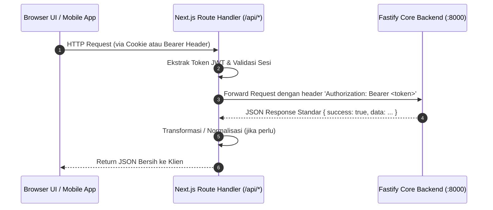

# 📋 Product Requirements Document — Web Dashboard & BFF (PRD-Web)
# Integrated Hospital Water Tank Monitoring & Early Warning System (RSA UGM)
### Platform: Next.js Web Dashboard & Backend-for-Frontend (BFF)

> **Repositori Target Pengembangan:** `frontend-web-rsa-ugm`  
> **Parent Documentation:** [`../PRD-MFE.md`](../PRD-MFE.md) *(Master Frontend PRD)* & [`../PRD.md`](../PRD.md) *(Backend Core)*  
> **Arsitektur:** Next.js 16.3 (App Router), React 19, Tailwind CSS v4, Zustand v5, Recharts v3, Lucide Icons  
> **Port Pengembangan:** `http://localhost:3000` (UI Web & Rute BFF)  
> **Status Dokumen:** Acuan Tunggal Spesifikasi Frontend Web & Rute BFF

---

## 1. Deskripsi Singkat, Visi & Peran Ganda Web

### 1.1 Visi Produk Web
Web Dashboard dirancang khusus untuk memonitor ketersediaan air rumah sakit secara terpusat melalui monitor **ultrawide / high-resolution** di ruang pengawas fasilitas (*control room*) Rumah Sakit Akademik UGM. Antarmuka harus menyajikan data multi-tangki secara komprehensif, cepat, responsif, dan memberikan sinyal darurat (*early warning*) yang mencolok seketika terjadi penurunan volume air.

### 1.2 Peran Ganda (Web Client + BFF Provider)
Repositori `frontend-web-rsa-ugm` memiliki **dua tanggung jawab utama**:
1. **Antarmuka Pengguna Web (Web UI Client):** Menyajikan dashboard visual, grafik analitik time-series, panel peringatan darurat, serta modul administratif untuk pengelola rumah sakit.
2. **Backend-for-Frontend (BFF) Provider:** Menjalankan lapisan perantara di sisi server (`src/app/api/*`) yang melayani klien Web sendiri dan klien **Mobile App (Android Expo)**. BFF bertugas:
   * Menjembatani komunikasi data ke Core Backend Fastify (`:8000`).
   * Mengamankan sesi pengguna Web dengan cookie `HttpOnly; SameSite=Lax; Secure` (anti-XSS).
   * Meneruskan token JWT murni kepada aplikasi Mobile.
   * Menyeragamkan format respon JSON agar komponen UI siap merender data tanpa manipulasi logika yang berat.

### 1.3 Batasan Ruang Lingkup Mutlak (Scope Boundaries)
* **Monitoring & Early Warning Only:** Web Dashboard fokus murni pada pemantauan level air, deteksi peringatan bahaya, konfirmasi penyelesaian alert (*Resolve Alert*), visualisasi time-series, dan manajemen data.
* **DILARANG MEMBUAT KONTROL POMPA:** Tidak ada tombol on/off pompa, saklar aktuator, atau katup fisik apa pun di UI. Seluruh instruksi aktuator ditiadakan dari sistem demi keselamatan fasilitas rumah sakit.

---

## 2. Tech Stack & Standar Lingkungan Pengembangan

| Komponen / Pustaka | Versi Terpasang | Peran & Penggunaan |
| :--- | :--- | :--- |
| **Framework Inti** | Next.js 16.3.6 (App Router) | Server-Side Rendering (SSR), Client Components, & Route Handlers (BFF) |
| **UI Library** | React 19.2.x & ReactDOM 19.2.x | Pustaka rendering UI berbasis komponen fungsional |
| **Styling & Theme** | Tailwind CSS v4 (@tailwindcss/postcss) | Utility-first CSS dengan CSS variables untuk dark/light medical mode |
| **State Management** | Zustand v5.0.x | Global client state (Tank Store, Alert Store, Auth Store, Device Store) |
| **Grafik Time-Series** | Recharts v3.10.x | Grafik area dan garis interaktif untuk visualisasi histori 24 jam |
| **Icon Pack** | Lucide React v1.47.x | Ikonografi modern (tangki, sinyal, alert, user, settings, log) |
| **HTTP Client** | Native `fetch` (ES2022) | Komunikasi asinkron server-to-server BFF dan client-to-BFF |
| **Package Manager** | `pnpm` v11.5.x | Package manager wajib untuk efisiensi disk dan instalasi deterministik |
| **Linter & Typecheck**| ESLint 9 & TypeScript 5.x | Menjamin type-safety dan kepatuhan standar kode |

### Variabel Lingkungan (`.env.local`)
```env
# Koneksi Server-to-Server BFF ke Core Backend Fastify
CORE_BACKEND_URL=http://localhost:8000

# URL WebSocket Realtime (Dihubungi langsung oleh Browser)
NEXT_PUBLIC_WS_URL=ws://localhost:8000/ws

# Environment Mode
NODE_ENV=development
```

---

## 3. Struktur Direktori & Arsitektur Layout Modular

Struktur folder `frontend-web-rsa-ugm/src` disusun secara modular memisahkan UI Halaman, Rute BFF, Komponen Reusable, dan State Management:

```text
src/
├── app/
│   ├── (auth)/
│   │   └── login/
│   │       └── page.tsx              # Layar Login Pengguna
│   ├── (dashboard)/
│   │   ├── layout.tsx                # DashboardLayout (Sidebar, Topbar, WebSocket Provider)
│   │   ├── page.tsx                  # Dashboard Overview (Multi-tank grid, alert banner)
│   │   ├── tanks/
│   │   │   ├── page.tsx              # Daftar Master Tangki & Pengaturan
│   │   │   └── [id]/
│   │   │       └── page.tsx          # Detail Tangki Tunggal & Grafik 24 Jam
│   │   ├── alerts/
│   │   │   └── page.tsx              # Riwayat Peringatan & Panel Resolve Alert
│   │   ├── devices/
│   │   │   └── page.tsx              # Status Gateway RPi & Node STM32
│   │   ├── users/
│   │   │   └── page.tsx              # Manajemen Pengguna (Khusus Admin)
│   │   ├── logs/
│   │   │   └── page.tsx              # Audit Trail Jejak Aktivitas Sistem
│   │   └── reports/
│   │       └── page.tsx              # Ekspor Laporan Data Sensor & Alert (.CSV)
│   ├── api/                          # LAPISAN BACKEND-FOR-FRONTEND (BFF)
│   │   ├── auth/
│   │   │   ├── login/route.ts        # POST: Login & Set Cookie HTTP-Only
│   │   │   ├── me/route.ts           # GET: Profil user dari cookie
│   │   │   └── logout/route.ts       # POST: Hapus cookie auth
│   │   ├── tanks/
│   │   │   ├── route.ts              # GET (list) & POST (tambah tangki)
│   │   │   └── [id]/
│   │   │       ├── route.ts          # GET (detail), PUT/PATCH (edit), DELETE
│   │   │       └── readings/route.ts # GET: Time-series log tangki spesifik
│   │   ├── readings/
│   │   │   ├── latest/route.ts       # GET: Fallback polling level air
│   │   │   └── history/route.ts      # GET: Agregasi 24 jam multi-tangki
│   │   ├── alerts/
│   │   │   ├── route.ts              # GET: Daftar alert aktif / riwayat
│   │   │   └── [id]/
│   │   │       └── resolve/route.ts  # PATCH/PUT: Selesaikan alert manual
│   │   ├── gateways/route.ts         # GET: Status Raspberry Pi Hub
│   │   ├── nodes/route.ts            # GET: Status modul sensor STM32
│   │   ├── users/
│   │   │   ├── route.ts              # GET & POST (CRUD User Admin)
│   │   │   └── [id]/route.ts         # PATCH & DELETE User
│   │   ├── audit-logs/route.ts       # GET: Rekaman audit aktivitas
│   │   ├── reports/
│   │   │   ├── readings/export/route.ts # GET: Proksi download CSV readings
│   │   │   └── alerts/export/route.ts   # GET: Proksi download CSV alerts
│   │   └── health/route.ts           # GET: Health check BFF & Fastify
│   ├── globals.css                   # Tailwind v4 tema & CSS variables
│   └── layout.tsx                    # Root Layout (Fonts, Global Providers)
├── components/
│   ├── ui/
│   │   ├── Sidebar.tsx               # Navigasi samping dengan state role aktif
│   │   ├── Header.tsx                # Topbar dengan status server, profil & lonceng alert
│   │   ├── Card.tsx                  # Base card surface
│   │   ├── LiquidLevelGauge.tsx      # Komponen visual silinder tangki dinamis
│   │   ├── AlertBanner.tsx           # Floating warning banner darurat di header
│   │   ├── TimeSeriesChart.tsx       # Recharts area/line chart interaktif 24 jam
│   │   ├── Modal.tsx                 # Modal dialog reusable (Single-Lock pattern)
│   │   ├── Badge.tsx                 # Indikator status (Normal, Warning, Critical)
│   │   └── Table.tsx                 # Tabel data generik dengan pagination & filter
├── hooks/
│   ├── useWebSocket.ts               # Hook koneksi WebSocket ke ws://...:8000/ws
│   └── useBFF.ts                     # Fetcher wrapper dengan proteksi error handling
├── stores/
│   ├── tankStore.ts                  # Zustand state tangki air
│   ├── alertStore.ts                 # Zustand state alert bahaya
│   ├── authStore.ts                  # Zustand state user, role & auth status
│   └── deviceStore.ts                # Zustand state status gateway & node
└── lib/
    ├── constants.ts                  # URL, status color codes, threshold constants
    └── utils.ts                      # Format angka liter, persen, waktu ISO
```

---

## 4. Rincian Implementasi Halaman & Fitur Web

### 4.1 Halaman Login (`/login`)
* **Tujuan:** Autentikasi petugas fasilitas dan administrator rumah sakit.
* **Elemen UI:**
  * Logo resmi RSA UGM & Judul: *"SI-POTA v1.0 — Sistem Informasi Pemantauan Tangki Air"*.
  * Input `username` dan `password`.
  * Tombol Submit *"Masuk ke Sistem"*.
  * Indikator pesan error jika kredensial salah (HTTP 401).
* **Alur Teknis:** Request dikirim ke `POST /api/auth/login` (BFF). Jika berhasil, BFF memasang cookie `auth_token` dan mengarahkan pengguna ke halaman `/`.

---

### 4.2 Dashboard Overview (`/`) — Layar Utama Ultrawide
* **Tujuan:** Tampilan monitoring utama yang dipajang di layar besar ruang kontrol.
* **Komponen & Tata Letak:**
  * **Header Alert Bar (`AlertBanner.tsx`):**
    * Jika ada alert berstatus `CRITICAL` ($<30\%$) atau `WARNING` ($30-60\%$), banner merah menyala muncul di posisi teratas dengan suara peringatan/animasi *pulse*.
    * Menampilkan pesan: *"PERINGATAN: [Nama Tangki] berada pada level [X]% — Segera lakukan inspeksi!"* beserta tombol cepat *"Lihat Detail"*.
  * **Ringkasan Kartu Metrik Cepat (Quick Stat Cards):**
    * Total Tangki Dipantau, Total Kapasitas Air (Liter), Tangki Kondisi Aman, Tangki Kondisi Kritis.
  * **Grid Multi-Tangki (`LiquidLevelGauge.tsx` + `Card.tsx`):**
    * Grid 3 kolom (standar) atau 4 kolom (ultrawide).
    * Setiap kartu memuat:
      * Nama Tangki (contoh: *Tangki Atap Gedung Utama*), Lokasi (*Lantai 5 Gedung A*).
      * Gauge Silinder Ketinggian Air interaktif dengan animasi pengisian.
      * Angka Persentase Ketinggian (contoh: `72.4%`) dan Estimasi Volume (contoh: `7.240 / 10.000 Liter`).
      * Badge Status: **NORMAL** (Hijau), **WARNING** (Kuning), atau **CRITICAL** (Merah).
      * Status Node LoRa: Indikator dot hijau dan kekuatan sinyal RSSI (`-74 dBm`).
      * Tombol *"Detail Tangki"* untuk membuka histori analitik.
  * **Grafik Agregasi Multi-Tangki 24 Jam (`TimeSeriesChart.tsx`):**
    * Visualisasi perbandingan fluktuasi level air seluruh tangki dalam 24 jam terakhir berbasis data dari `GET /api/readings/history`.

---

### 4.3 Detail Tangki & Grafik Histori (`/tanks/[id]`)
* **Tujuan:** Analisis mendalam kondisi 1 tangki tertentu.
* **Elemen UI:**
  * Silinder air ukuran besar dengan batas threshold garis putus-putus (`minThresholdPercent` dan `maxThresholdPercent`).
  * Rentang Filter Grafik: Pilihan tombol waktu `24 Jam`, `7 Hari`, `30 Hari`.
  * Grafik Garis Recharts interaktif yang menampilkan titik waktu dan persentase air saat kursor diarahkan (*tooltip*).
  * Tabel 50 Riwayat Pembacaan Terakhir (Waktu Pengukuran, Persentase %, Estimasi Liter, RSSI Radio).
  * Panel Peringatan Terkait: Riwayat alert yang pernah terjadi pada tangki ini.

---

### 4.4 Panel Peringatan & Penyelesaian Alert (`/alerts`)
* **Tujuan:** Pusat komando penanganan kondisi darurat level air.
* **Elemen UI:**
  * Tab Filter: **Alert Aktif** vs **Semua Riwayat Alert**.
  * Tabel Data Alert:
    * Tingkat Bahaya (`CRITICAL` dengan badge merah, `WARNING` dengan badge kuning).
    * Nama Tangki Terkena Dampak & Waktu Kejadian.
    * Pesan Deteksi Otomatis dari Warning Engine.
    * Status: `active` atau `resolved`.
    * **Aksi "Resolve Alert" (Khusus Role `admin` & `operator`):**
      * Menampilkan tombol *"Selesaikan"* pada alert yang berstatus `active`.
      * Membuka modal konfirmasi penyelesaian.
      * Mengirim request ke `PATCH /api/alerts/[id]/resolve`.
      * Seketika status berubah menjadi `resolved`, banner darurat tertutup, dan tercatat di audit log.

---

### 4.5 Status Perangkat IoT & Gateway (`/devices`)
* **Tujuan:** Memantau keandalan perangkat keras komunikasi radio (LoRa & RPi).
* **Elemen UI:**
  * **Kartu Gateway Raspberry Pi:**
    * Kode Perangkat: `GW-HUB-01`.
    * Status: `Online` (Hijau) / `Offline` (Abu-abu/Merah).
    * Heartbeat Terakhir: Waktu sinkronisasi terakhir dari hub RPi.
  * **Tabel Node Sensor STM32:**
    * Kode Node (contoh: `NODE-TNK-01`), Tangki Terpasang, Tipe Sensor (`ultrasonic`).
    * Nilai Sinyal LoRa (RSSI): Indikator bar kekuatan sinyal (contoh: `-70 dBm` = Kuat, `-105 dBm` = Lemah).
    * Status Node: `active`, `offline`, atau `error`.

---

### 4.6 Pengaturan Master Tangki (`/tanks` — Khusus Admin)
* **Tujuan:** Pengelolaan data fisik tangki air di lingkungan rumah sakit.
* **Elemen UI:**
  * Tombol *"Tambah Tangki Baru"*: Membuka modal formulir (Nama Tangki, Lokasi Gedung, Kapasitas Liter, Batas Ambang Bawah/Min %, Batas Ambang Atas/Max %).
  * Aksi Edit pada Baris Tangki: Memperbarui kapasitas atau batas peringatan jika ada penggantian pelampung/sensor.
  * Aksi Hapus Tangki: Dengan modal konfirmasi peringatan keamanan.

---

### 4.7 Manajemen Pengguna & Hak Akses (`/users` — Khusus Admin)
* **Tujuan:** Mengatur akun petugas yang berhak mengakses sistem.
* **Elemen UI:**
  * Tabel Pengguna: `Username`, `Role` (`admin`, `operator`, `viewer`), `Status Aktif`, `Tanggal Dibuat`.
  * Tombol *"Tambah Pengguna"*: Input username, password awal, dan pemilihan peran.
  * Aksi Edit: Ubah peran (misal dari viewer menjadi operator) atau Reset Password.
  * Aksi Nonaktifkan: Mengubah `isActive` menjadi `false` untuk mencabut akses sementara.

---

### 4.8 Jejak Audit & Ekspor Dokumen (`/logs` & `/reports`)
* **Halaman Audit Trail (`/logs`):**
  * Tabel linimasa seluruh aksi penting: Waktu, Pengguna, Jenis Aksi (`LOGIN`, `RESOLVE_ALERT`, `UPDATE_TANK`), Entitas Terkait, Alamat IP Pengakses.
* **Halaman Ekspor Laporan (`/reports`):**
  * Filter rentang tanggal: Tanggal Mulai (*From*) s.d. Tanggal Selesai (*To*).
  * Filter Tangki Tertentu atau Seluruh Tangki.
  * Tombol Unduh:
    * *"Download CSV Pembacaan Sensor"* (memanggil `GET /api/reports/readings/export`).
    * *"Download CSV Riwayat Peringatan"* (memanggil `GET /api/reports/alerts/export`).

---

## 5. Spesifikasi Lengkap Implementasi Rute BFF (`src/app/api/*`)

Setiap rute API Next.js bertindak sebagai *handler* server yang mengamankan token, memproksikan request ke Core Backend Fastify (`CORE_BACKEND_URL`), dan mengembalikan data bersih ke klien:



### 5.1 Implementasi Kunci Handler BFF

#### 1. Autentikasi: `src/app/api/auth/login/route.ts`
```typescript
import { NextResponse } from "next/server";
import { cookies } from "next/headers";

export async function POST(request: Request) {
  const body = await request.json();
  const beRes = await fetch(`${process.env.CORE_BACKEND_URL}/api/auth/login`, {
    method: "POST",
    headers: { "Content-Type": "application/json" },
    body: JSON.stringify(body),
  });

  const data = await beRes.json();
  if (!beRes.ok || !data.success) {
    return NextResponse.json(data, { status: beRes.status });
  }

  const token = data.data.token;
  const cookieStore = await cookies();
  
  // Pasang cookie HTTP-Only untuk browser web
  cookieStore.set("auth_token", token, {
    httpOnly: true,
    secure: process.env.NODE_ENV === "production",
    sameSite: "lax",
    path: "/",
    maxAge: 60 * 60 * 24, // 1 hari
  });

  // Tetap kembalikan data user & token (token untuk kebutuhan mobile Axios)
  return NextResponse.json(data, { status: 200 });
}
```

#### 2. Profil Pengguna: `src/app/api/auth/me/route.ts`
```typescript
import { NextResponse } from "next/server";
import { cookies } from "next/headers";

export async function GET(request: Request) {
  const cookieStore = await cookies();
  const tokenFromCookie = cookieStore.get("auth_token")?.value;
  const tokenFromHeader = request.headers.get("authorization")?.replace("Bearer ", "");
  const token = tokenFromCookie || tokenFromHeader;

  if (!token) {
    return NextResponse.json({ success: false, message: "Belum login" }, { status: 401 });
  }

  const beRes = await fetch(`${process.env.CORE_BACKEND_URL}/api/auth/me`, {
    headers: { Authorization: `Bearer ${token}` },
  });

  const data = await beRes.json();
  return NextResponse.json(data, { status: beRes.status });
}
```

#### 3. Proksi Monitoring Tangki: `src/app/api/tanks/route.ts`
```typescript
import { NextResponse } from "next/server";
import { cookies } from "next/headers";

export async function GET(request: Request) {
  const cookieStore = await cookies();
  const token = cookieStore.get("auth_token")?.value || request.headers.get("authorization")?.replace("Bearer ", "");

  const headers: Record<string, string> = { "Content-Type": "application/json" };
  if (token) headers["Authorization"] = `Bearer ${token}`;

  const beRes = await fetch(`${process.env.CORE_BACKEND_URL}/api/tanks`, {
    headers,
    cache: "no-store",
  });

  const data = await beRes.json();
  return NextResponse.json(data, { status: beRes.status });
}
```

---

## 6. Integrasi WebSocket Realtime di Sisi Web Client

Komponen dashboard web tidak melakukan polling HTTP berulang kali, melainkan mendengarkan event streaming secara langsung dari Core Backend menggunakan custom hook `useWebSocket`:

### Implementasi Hook `src/hooks/useWebSocket.ts`
```typescript
"use client";

import { useEffect, useRef, useState } from "react";
import { useTankStore } from "@/stores/tankStore";
import { useAlertStore } from "@/stores/alertStore";
import { useDeviceStore } from "@/stores/deviceStore";

export function useWebSocket() {
  const [isConnected, setIsConnected] = useState(false);
  const reconnectTimeoutRef = useRef<NodeJS.Timeout | null>(null);

  const updateTankLevel = useTankStore((state) => state.updateTankLevel);
  const addActiveAlert = useAlertStore((state) => state.addActiveAlert);
  const removeActiveAlert = useAlertStore((state) => state.removeActiveAlert);
  const updateNodeStatus = useDeviceStore((state) => state.updateNodeStatus);

  useEffect(() => {
    const wsUrl = process.env.NEXT_PUBLIC_WS_URL || "ws://localhost:8000/ws";
    let socket: WebSocket | null = null;

    function connect() {
      socket = new WebSocket(wsUrl);

      socket.onopen = () => {
        setIsConnected(true);
        console.log("[WebSocket] Terhubung ke Fastify Realtime Core");
      };

      socket.onmessage = (event) => {
        try {
          const payload = JSON.parse(event.data);
          switch (payload.event) {
            case "LEVEL_UPDATE":
              updateTankLevel(
                payload.data.tankId,
                payload.data.levelPercent,
                payload.data.volumeLiters,
                payload.data.rssi
              );
              break;
            case "ALERT_TRIGGERED":
              addActiveAlert(payload.data);
              break;
            case "ALERT_RESOLVED":
              removeActiveAlert(payload.data.id);
              break;
            case "NODE_STATUS":
              updateNodeStatus(payload.data.nodeId, payload.data.status, payload.data.lastRssi);
              break;
          }
        } catch (err) {
          console.error("[WebSocket] Gagal memproses event:", err);
        }
      };

      socket.onclose = () => {
        setIsConnected(false);
        console.warn("[WebSocket] Terputus. Menjadwalkan reconnect dalam 5 detik...");
        reconnectTimeoutRef.current = setTimeout(connect, 5000);
      };

      socket.onerror = (err) => {
        console.error("[WebSocket] Error:", err);
        socket?.close();
      };
    }

    connect();

    return () => {
      if (reconnectTimeoutRef.current) clearTimeout(reconnectTimeoutRef.current);
      socket?.close();
    };
  }, [updateTankLevel, addActiveAlert, removeActiveAlert, updateNodeStatus]);

  return { isConnected };
}
```

---

## 7. Design System & Panduan Visual Ultrawide

### 7.1 Token Warna Status & CSS Variables
Sistem menggunakan Tailwind CSS v4 dengan variabel semantik di `globals.css`:

```css
:root {
  --color-brand-primary: #0a354c;
  --color-brand-teal: #0f766e;
  
  /* Status Level Air */
  --color-level-normal: #10b981;  /* Hijau: > 60% */
  --color-level-warning: #f59e0b; /* Kuning: 30% - 60% */
  --color-level-critical: #ef4444;/* Merah: < 30% */

  /* Surface */
  --bg-dashboard: #0b132b;
  --bg-card: #1c2541;
  --text-main: #f8fafc;
  --text-muted: #94a3b8;
  --border-card: #3a506b;
}
```

### 7.2 Spesifikasi Komponen `LiquidLevelGauge`
* Menampilkan visual silinder tangki transparan beranimasi ombak air halus (CSS animation).
* Ketinggian gelombang air di dalam silinder terikat langsung pada variabel `levelPercent` (0% s.d. 100%).
* Warna air berubah secara dinamis:
  * Hijau jika $> 60\%$
  * Kuning berdenyut jika $30\% - 60\%$
  * Merah menyala dengan efek strobo/kedip halus jika $< 30\%$

---

## 8. Pipeline CI & Alur Kontribusi Git Web

Sesuai arahan Bab 9 Master PRD, repositori `frontend-web-rsa-ugm` diproteksi ketat:

### 8.1 File Konfigurasi CI: `.github/workflows/ci.yml`
```yaml
name: Web CI (Lint, Typecheck & Build)

on:
  push:
    branches:
      - "feat/*"
  pull_request:
    branches:
      - dev
      - main

jobs:
  validate-and-build:
    name: Lint, Typecheck & Next.js Build
    runs-on: ubuntu-latest
    steps:
      - name: Checkout Code
        uses: actions/checkout@v4

      - name: Install pnpm
        uses: pnpm/action-setup@v3
        with:
          version: 11

      - name: Setup Node.js 20 LTS
        uses: actions/setup-node@v4
        with:
          node-version: 20
          cache: "pnpm"

      - name: Install Dependencies
        run: pnpm install --frozen-lockfile

      - name: Code Linting
        run: pnpm run lint

      - name: Strict TypeScript Check
        run: npx tsc --noEmit

      - name: Next.js Production Build Test
        run: pnpm run build
        env:
          CORE_BACKEND_URL: "http://localhost:8000"
          NEXT_PUBLIC_WS_URL: "ws://localhost:8000/ws"
```

---

## 9. Panduan Memulai Cepat untuk Pengembang (Developer Onboarding)

1. Masuk ke direktori web:
   ```bash
   cd frontend-web-rsa-ugm
   ```
2. Pastikan dependensi pnpm terpasang:
   ```bash
   pnpm install
   ```
3. Salin konfigurasi environment:
   ```bash
   cp .env.example .env.local
   ```
4. Jalankan server pengembangan lokal:
   ```bash
   pnpm dev
   ```
5. Akses dashboard di peramban pada alamat `http://localhost:3000`.
6. Lakukan verifikasi kode sebelum mengajukan Pull Request:
   ```bash
   pnpm run lint && npx tsc --noEmit && pnpm run build
   ```
